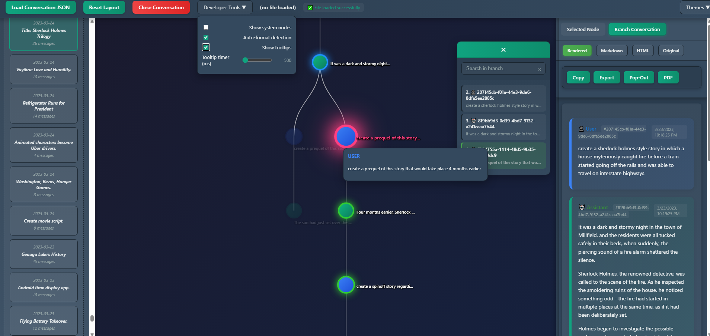

This is **vibe coded software**.

---

# 🌳 ChatGPT JSON Tree Viewer

**Your AI conversation is a tree. Every viewer shows you a list. This one shows you the tree.**

Load an export from ChatGPT, Claude, Grok, DeepSeek, Qwen, Mistral, GLM or opencode — or just a Markdown transcript — and get a map you can actually explore: every branch, every regenerated answer, every "wait, which version did I keep?" moment.

*One HTML file · no build step · no account · MIT*

Main UI


---

## The problem you already know

You ask a question. The answer is *almost* right. You hit **Regenerate**. Then again. And again.

The model keeps one of those answers. The other four disappear — along with that side question you asked three messages ago, and the entire conversation that quietly grew out of it.

Your export still has all of it. It's just… JSON. A wall of `mapping`, `parent`, `children` and UUIDs that no human should read on purpose.

This viewer reads it so you don't have to.

## A tree, not a list

```text
                         ┌── You: "shorter" ──── Assistant B
You: "Explain recursion" ┤
                         └── Assistant A   ← the one that stayed
```

That's the whole idea. A list view flattens this into a tidy column and quietly drops the branch you didn't pick. The export didn't. This app draws what the export actually contains — including the answers the interface forgot.

## How it compares

| | The chat interface | This viewer |
| --- | --- | --- |
| Regenerated answers | Only the one that stayed | Every branch, still readable |
| Shape of a conversation | One long scroll | A tree you can pan, zoom and prune |
| Getting it out | Copy, paste, reformat | PDF, HTML, Markdown, JSON, PNG or SVG |
| Where it runs | Their servers | Your browser tab |
| Offline | No | Yes, once the page has loaded |

## What you get

**A real tree, not a timeline.** Every message is a node, every regeneration is a sibling branch, and you can pan, zoom and click your way through the whole thing. There's a minimap for when the tree gets ambitious. Colors tell you who's talking — blue for you, green for the model, grey dashed for the system messages hiding in the plumbing.

**A branch panel that keeps its bearings.** Pick any node and see the exact path that leads to it — role chips, message previews, model names and timestamps, top to bottom. To compare regenerations, click the competing sibling in the graph and the panel redraws with its path.

**Search that finds the thing you half-remember.** Full-text across every loaded conversation, grouped by conversation, with matches highlighted. No more scrolling through 400 messages hunting for "the bit about the database".

**Copy anything, in whatever shape you need.** Rendered (formatting intact), Markdown, HTML or raw JSON — per message, per selection, or the entire conversation. The changelog has the same treatment, because of course it does.

**Pop any message — or the whole branch — into its own tab.** A real tab beside the app, not a cramped little window, with the same branded header, a view switcher and copy buttons that follow whatever view you're in.

**Get it out of the browser.** Print-ready PDF, the visible branch as HTML / Markdown / JSON (it follows your view), and the graph itself as PNG, JPG or SVG.

**Themes, including the one you didn't ask for.** System (follows your OS light/dark setting, live), light, dark, blue, green, purple — and **Windows XP**, Luna chrome and all. There's a color picker too, if you're feeling artistic.

**It fits in your pocket.** Single-column layout, bottom navigation, pinch-zoom and two-finger pan on phones.

**Big files don't scare it.** A 300 MB export gets split in a background worker and imported chunk by chunk, without freezing the tab. And a **Files** panel lets you keep only the files you're reading in memory — untick one and its conversations are released; tick it again and they're reloaded from disk.

**ZIP straight from your inbox.** Drop the ChatGPT export `.zip` as-is. It unpacks in the browser, ignores `chat.html` and the other paperwork, and treats `conversations-000.json`, `-001.json`, … as one export instead of twenty.

**A help section that actually helps.** 18 searchable topics, plus the full changelog with copy buttons and a raw Markdown view — and a tooltip on essentially every control, so nothing is a mystery button.

## Four things people actually do with it

**1. Rescue the answer they threw away.** You regenerated six times and kept the third. The other five are still in the file, still readable, still possibly better. Search for a phrase you remember, click the node, read the one that got away.

**2. Find where a conversation went sideways.** Follow the path to a disappointing answer, find the prompt that caused it, then hop to the sibling branch and see what a different wording produced. It turns "the model got worse" into "this sentence confused it".

**3. Treat sibling branches like a tiny eval.** Same prompt, five regenerations, five nodes side by side. Read them in order, copy the winner, and pretend you meant to do that all along.

**4. Take one branch and leave the rest.** Prune the noise in the view, export the branch you care about as Markdown or HTML, and keep a clean record without the twenty dead ends. Your original export is never modified.

## What it deliberately doesn't do

- **It doesn't edit your export.** Delete Node removes a node from the in-memory copy (and therefore from anything you export afterwards); Start Over puts it back. The file on your disk is untouched.
- **It doesn't talk to OpenAI, Anthropic or anyone else.** No login, no API key, no "connect your account". It reads the file you hand it.
- **It doesn't sync or store anything.** Close the tab and the session is gone — which is the point. Reopen the file when you need it again.
- **It can't resurrect what the platform already deleted.** Edited messages, regenerations that never reached the export, and server-side deletions aren't in the JSON, so they aren't here either.
- **It isn't a chat client.** You can't send messages, and it won't pretend to be one.

## Your conversations stay yours

Everything runs in your browser. The file you drop in is parsed, rendered and kept entirely in the tab — there is no server, no account, no upload, no analytics and no telemetry.

The third-party libraries are pinned with SRI integrity hashes and the page ships a Content Security Policy, so a tampered CDN file gets refused rather than executed. Message bodies are sanitised before rendering, and imported titles, model names and node IDs are escaped everywhere they appear. Imported files are treated as what they are: untrusted input.

The short version: your chats never leave your machine, and the app is built to keep it that way.

## Opening it (and what to click first)

1. Download `chatgpt-json-tree-viewer.html`
2. Double-click it — that *is* the install
3. Drop your export onto the graph, or hit **Load File**
4. Click any node to see its branch path; right-click for copy, select and delete
5. Use the ↗ button on a message or branch when you want it in a tab of its own

No build step, no `npm install`, no "please create an account to continue". One file, one browser tab.

Haven't exported yet? ChatGPT hides it under **Settings → Data Controls → Export Data** (you get an email with a ZIP — drop the ZIP itself, no need to extract it; `conversations.json` and its numbered parts are found automatically). Claude: **Settings → Export Data**. Everyone else: poke around settings for "export".

It needs an internet connection the first time (the pinned libraries and fonts come from a CDN, then your browser caches them). After that, everything works offline except importing an opencode `.db`, which fetches the SQLite engine on demand.

Updating is the same operation in reverse: download the new HTML over the old one. Theme and settings live in `localStorage`; your conversations were never stored, so drop the export again when you want them back.

## Quick reference

| I want to… | Do this |
| --- | --- |
| Read a message | Click its node |
| See how it was reached | The Branch panel redraws with its full path |
| Compare regenerations | Click the competing sibling node |
| Pan | Drag the graph |
| Zoom | Scroll wheel, pinch, or the **+** / **−** buttons |
| Act on a node | Right-click it: Copy Message / Select & View / Delete Node |
| Act on a conversation | Right-click it: Show Only / Start Over / Export Conv / Delete Conv |
| Close a dialog | Escape |
| Free memory | Untick a file in the Files panel |
| Take something with you | The Copy, Export and Print buttons |

## What it reads

| Where your chats live | What to drop in |
| --- | --- |
| ChatGPT / OpenAI export | the `.zip` itself, or `conversations.json` / `conversations-000.json` |
| Claude (new and classic exports) | `.json` |
| DeepSeek (exporter, chat export, conversation) | `.json` |
| Grok / xAI backend export | `.json` |
| Mistral | `.json` |
| GLM / Zhipu | `.json` |
| Qwen Chat | `.json` |
| opencode | `opencode.db` (`.db`, `.sqlite`, `.sqlite3`) |
| Anything else | `.md`, `.markdown`, `.txt` — parsed as a transcript |

Multiple files at once? Sure. Each becomes its own entry in the sidebar, with a checkbox in the **Files** panel so you can load only the ones you need. Format detection is automatic, and branching survives the trip wherever the source format recorded it.

## Small things that add up

- A minimap, breadcrumbs and role filters, so a 200-message tree stays navigable
- Drag either side panel to whatever width you like — the graph takes the rest
- Search results grouped by conversation, collapsible with one click
- The Files panel shows a live conversation count and file size, so you can see what's eating memory
- Notifications instead of silent failures when a file won't parse
- Escape closes any open dialog — there's no keyboard maze to learn
- Everything is a single HTML file — copy it to a USB stick and it still works

## If something goes wrong

**Nothing happens when I drop a file.** Open the browser console. If the file is very large, the tab may have run out of memory before parsing started — split it first, then load the parts.

**The toast says "0 new, N skipped".** Those conversations were already loaded; deduplication is by conversation id, not by filename. Check the Files panel before assuming the import failed.

**The ZIP won't open.** Either the browser is older than `DecompressionStream` (Chrome/Edge 103+, Firefox 113+, Safari 16.4+) or the archive is password-protected. Extract `conversations.json` and drop that instead.

**The graph is blank but the sidebar is full.** Click a conversation. The graph only draws the active one, and closing a conversation leaves the list intact.

**The fonts look wrong.** The first load needs internet for the pinned libraries and Google Fonts. After that they're cached and the app works offline.

**I closed the tab and lost everything.** There's no persistence, deliberately. Reopen the file and drop your export again — it takes seconds, and it means nothing is left behind on a shared machine.

## FAQ

**Does it upload my conversations?** No. There is no backend. The only network requests are for the pinned CDN libraries and fonts.

**Can I edit my chats?** No, and that's the point. It's a viewer with a pruning knife (Delete Node), not an editor. Nothing is written back to your export.

**Why one HTML file?** Because "download this, then run `npm install`" is how side projects die. One file can be emailed, put on a USB stick, or opened from a Downloads folder in five years.

**Does it work offline?** After the first load, yes — except importing an opencode `.db`, which fetches the SQLite engine on demand.

**Will it open a 2 GB export?** The splitter helps, but browser tabs have limits. A few hundred MB is comfortable; beyond that, split first and use the Files panel to keep only what you're reading.

**Is this affiliated with OpenAI?** No. It's an independent viewer for the exports they — and several other platforms — produce.

**Which browsers?** Current Chrome, Edge, Firefox and Safari. ZIP import is the only feature with a hard version floor (see above).

## Under the hood

One HTML file, about 9,000 lines and 470 KB, no build step and no framework. D3 draws the graph, marked and DOMPurify handle message rendering, html2canvas does raster exports, sql.js reads opencode databases, and the ZIP reader is hand-rolled on top of the browser's own `DecompressionStream` because pulling in a library for it felt rude.

CSS variables do the themes. The Windows XP one is a love letter and an apology.

## About that "vibe coded" label

It's one HTML file containing all the CSS and JavaScript, assembled by a human and a rotating cast of language models, then bullied into shape by an unreasonable number of edge cases and a headless browser.

There is no test suite. The test suite is a person clicking things and saying "huh, that shouldn't do that." Which is also how most of the features got added.

It works, it's honest about it, and the whole thing is small enough to read if you don't trust either of us.

## Release notes

Releases live in the in-app changelog: Help → **🆕 What's New**, with copy buttons for the whole log or a single release, in rendered, Markdown or HTML form.

## Libraries used

| Library | Purpose |
| --- | --- |
| [D3.js](https://d3js.org) v7.9.0 | Interactive tree map |
| [marked](https://marked.js.org) v9.1.6 | Markdown → HTML rendering |
| [DOMPurify](https://github.com/cure53/DOMPurify) v3.0.6 | Sanitising rendered message HTML |
| [html2canvas](https://html2canvas.hertzen.com) v1.4.1 | PNG / JPG export of the graph |
| [sql.js](https://sql.js.org) v1.10.3 | In-browser SQLite, for reading opencode databases |

Fonts: [DM Sans](https://fonts.google.com/specimen/DM+Sans), [Literata](https://fonts.google.com/specimen/Literata) and [JetBrains Mono](https://fonts.google.com/specimen/JetBrains+Mono), served via Google Fonts.

---

## License

MIT — free to use, modify, and share. See [LICENSE](LICENSE) for details.

---

## Star History

[](https://www.star-history.com/#akivacp/chatgpt-json-tree-viewer&type=date&legend=top-left)
